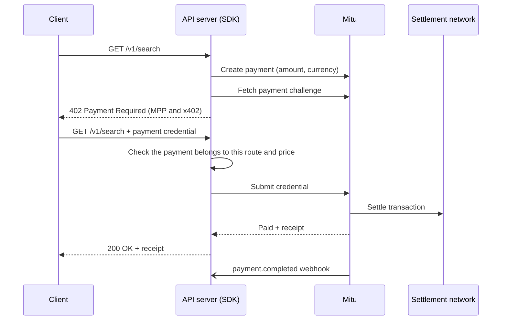

# Mitu Payments SDKs

Server-side SDKs for monetizing APIs and digital services with machine payments. They put any HTTP endpoint behind a
per-request payment that AI agents and other machine clients can pay with the open
[Machine Payments Protocol](https://mpp.dev) (MPP) and [x402](https://x402.org) standards. Proceeds settle through
Mitu in the merchant's local currency.

The SDKs are a thin integration layer over Mitu's payment API. Mitu issues the payment challenges, settles each
payment on chain as the facilitator, locks the exchange rate, and notifies the merchant. The SDKs create a payment for
each request, relay the challenge and the client's payment to Mitu, and run the endpoint only once Mitu confirms the
payment.

| Language | Package | Supported frameworks |
| --- | --- | --- |
| TypeScript | [`@mitulabs/payments`](typescript) | Express, Hono, Next.js, Elysia, Fetch API (Cloudflare Workers, Deno, Bun) |
| Python | [`mitulabs-payments`](python) | FastAPI, Flask, Django |
| Go | [`github.com/mitulabs/payments/go`](go) | `net/http`, chi, Gin, Echo, Fiber |

## Use cases

- Per-request pricing for public and partner APIs
- Paid access to data, inference, search and other compute-heavy endpoints
- Payment-gated tools and resources for AI agents and MCP clients
- Machine-to-machine billing without client accounts, API keys or invoices

## Payment flow



Payments are verified and settled by Mitu, never by the SDK. The endpoint runs only after Mitu confirms settlement.
Each payment is bound to the route and price it was created for, so a payment for one endpoint cannot unlock another.

Clients use any standard MPP or x402 client, such as the `mppx` CLI, Coinbase's x402 clients or agent wallets. The
payment methods offered are those enabled on the merchant's Mitu account.

## Requirements

- A Mitu merchant account and a secret API key (`sk_live_...`)
- Node.js 22.12+, Python 3.12+ or Go 1.26+

## Getting started

### TypeScript

```bash
npm install @mitulabs/payments
```

```ts
import express from 'express'
import { createMitu } from '@mitulabs/payments'
import { charge } from '@mitulabs/payments/express'

const mitu = createMitu({ apiKey: process.env.MITU_API_KEY! })

const app = express()

app.get('/v1/search', charge(mitu, { amount: '0.05', currency: 'USD' }), (req, res) => {
  res.json(search(req.query))
})
```

### Python

```bash
pip install "mitulabs-payments[fastapi]"
```

```python
mitu = Mitu(os.environ["MITU_API_KEY"])


@app.get("/v1/search")
@mitu.charge(amount="0.05", currency="USD")
async def search(request: Request):
    return run_search(request.query_params)
```

### Go

```bash
go get github.com/mitulabs/payments/go
```

```go
m, err := mitu.New(ctx, mitu.Options{APIKey: os.Getenv("MITU_API_KEY")})
if err != nil {
	log.Fatal(err)
}

mux.Handle("GET /v1/search", m.Charge(mitu.Price{Amount: "0.05", Currency: "USD"})(http.HandlerFunc(search)))
```

Complete configuration, framework integrations and error handling: [TypeScript](typescript/README.md),
[Python](python/README.md), [Go](go/README.md).

## Pricing

Prices are set on the server per route, either as a fixed amount or as a function of the request. A price may be in
USD or in any currency enabled on the merchant account; Mitu locks the exchange rate when the payment is created, so
the amount requested and the amount settled always agree. Amounts are positive with at most two decimal places.

## Security

- Payment verification and settlement are performed by Mitu. The SDKs never accept a payment Mitu has not confirmed.
- A payment is accepted only for the route, method, amount and currency it was created for.
- The API key is sent only to the Mitu API. It is never forwarded to payment endpoints, logged or included in errors.
- Only payment credentials are relayed to Mitu; only payment headers are returned to the client.
- If Mitu cannot be reached, the endpoint responds `503 Service Unavailable` with `Retry-After` and does not run.

Report vulnerabilities to security@mitu.ai. Do not open public issues for security reports.

## Development

Each SDK is versioned, tested and released independently. CI runs only for the packages affected by a change.

| Package | Setup | Verification |
| --- | --- | --- |
| TypeScript | `npm ci` | `npm run lint && npm run typecheck && npm test && npm run build` |
| Python | `pip install -e ".[dev]"` | `ruff check . && ruff format --check . && mypy --strict src && pytest` |
| Go | — | `gofmt -l . && go vet ./... && go test -race ./...` (also in `gin/`, `echo/`, `fiber/`) |

Releases are published from CI with tags of the form `ts/vX.Y.Z`, `py/vX.Y.Z` and `go/vX.Y.Z`
(Go adapters: `go/gin/vX.Y.Z`, `go/echo/vX.Y.Z`, `go/fiber/vX.Y.Z`). npm packages are published with provenance.

## License

[MIT](LICENSE)
